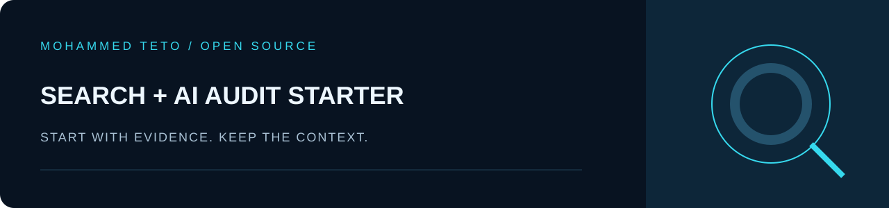
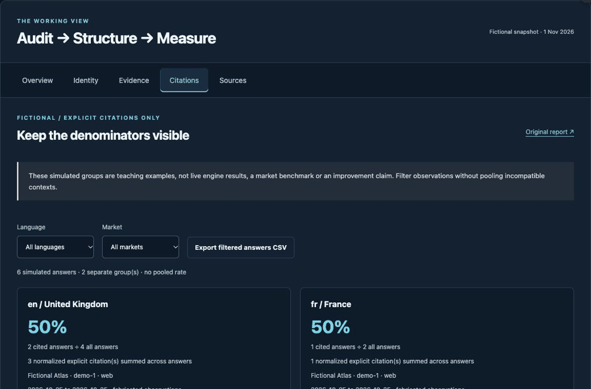

<p align="center"></p>

# Search and AI Audit Starter

[](https://github.com/mhdteto/search-ai-audit-starter/actions/workflows/verify.yml)

**Your starting workspace for an international search and AI reputation audit.** Learn from five pinned tools, record your evidence, and run a separate bounded observation of an authorized public page.

[**Use this template →**](https://github.com/new?template_name=search-ai-audit-starter&template_owner=mhdteto) · [Try the browser explorer](https://mhdteto.github.io/authority-architecture-system/) · [Read the method](https://github.com/mhdteto/authority-architecture-system) · [Real first-party case](https://github.com/mhdteto/authority-architecture-system/tree/main/case-studies/mohammedteto-com)

Created by **Mohammed Teto — AI Reputation & Authority Strategist**, serving leaders and organizations internationally. [Advisory practice](https://mohammedteto.com/).

[Français — guide de démarrage](docs/QUICKSTART.fr.md) · [Release notes](CHANGELOG.md)

## See the workflow in action

[](https://mhdteto.github.io/authority-architecture-system/#citations)

Actual browser capture; fictional teaching observations. Plays once. [Static screenshot](.github/readme-assets/explorer-static.png) · [Text walkthrough and actual exported sample](https://github.com/mhdteto/authority-architecture-system/blob/main/docs/explorer-walkthrough.md).

[Start your own audit](https://github.com/mhdteto/search-ai-audit-starter) · [Use the GitHub Action](https://github.com/mhdteto/search-ai-audit-action) · [Read the real first-party baseline](https://github.com/mhdteto/authority-architecture-system/tree/main/case-studies/mohammedteto-com).

## 1. Create your workspace

Click **Use this template → Create a new repository**. Choose your own name and visibility. For local use, download the ZIP, extract it, then open a terminal in the extracted root folder. Python 3.10+ is recommended; no Python packages or API keys are needed.

## 2. Learn offline first

```sh
python3 audit.py demo
```

This runs the five frozen tools on entirely invented Alex Rowan / Cedar Notes inputs. It regenerates 17 report files under `examples/fictional-workflow/reports/`. Open the HTML files for discoverability, identity, evidence, structured data and citations. No target website or AI provider is queried.

The expected observations include two mismatched identity fields, three missing fields, an unsupported office claim and separate English/UK and French/France citation groups. These are teaching data, not market statistics or proof of business impact.

[Exact tool commands and provenance](examples/fictional-workflow/README.md) · [Three decision-led tutorials](https://github.com/mhdteto/authority-architecture-system/tree/main/tutorials).

## 3. Observe one real public page separately

```sh
python3 audit.py live https://example.org/ --output-dir reports/live
```

Replace the URL with a public page you are authorized to inspect. Open `reports/live/report.html`; preserve `report.json` and its collection date. The command uses the same frozen bounded checker and makes at most 12 HTTP requests including redirects. Real transport is labeled `live public HTTP(S)`. No fictional identity, evidence or citation reports are attached to that observation.

**HTTP 200 and valid markup do not establish indexing, ranking, correct entity descriptions or AI citations.** This is one page plus robots.txt and one sitemap candidate, not a full site crawl. Review all stated limits before drawing a conclusion.

## 4. Make it an actual audit

Complete the [project brief](notes/project-brief.md), [observation register](notes/observation-register.csv) and [decision register](notes/decision-register.csv). Put approved inputs in `inputs/private/`; follow [input guidance](inputs/README.md). Keep one language/market context per comparable measurement group. Do not assume that translating prompts or aliases preserves meaning.

For identity, claims, structured data or citations, use the exact tool command shown in the frozen example, pointing to your approved inputs and a separate `reports/` destination. Review relationships and claims manually; the tools do not verify their truth or collect live LLM answers.

## 5. Run on GitHub

The default verification workflow replays only the fictional demo and consumes the pinned [reusable Action](https://github.com/mhdteto/search-ai-audit-action) with a fixture. It uploads fictional reports for seven days.

For a live observation: **Actions → Observe an authorized public page → Run workflow**, replace the example URL, then download the `live-discoverability` artifact. This is a manual workflow; no recurring scan or provider API cost is installed. Public repository artifacts/logs can be read by others: do not supply confidential URLs or records.

## What is bundled

| Area | Purpose |
| :--- | :--- |
| `audit.py` | Explicit `demo` and `live` entry points. |
| `examples/fictional-workflow/` | Frozen inputs, five tool snapshots, 17 reports, original licenses and source hashes. |
| `inputs/` | Guidance for approved inputs; private subfolder is git-ignored. |
| `notes/` | Scope, observations, human decisions and follow-up register. |
| `.github/workflows/` | Offline verification plus manually triggered live observation. |

[Community and FAQ](https://github.com/mhdteto/authority-architecture-system/discussions) · [Public roadmap](https://github.com/users/mhdteto/projects/1) · [Contribution guide](CONTRIBUTING.md).

Code is MIT; original docs, examples and artwork are CC BY 4.0 with attribution. Bundled snapshots retain their original notices. No third-party client data is included and no employer or search/AI provider endorsement is implied.
